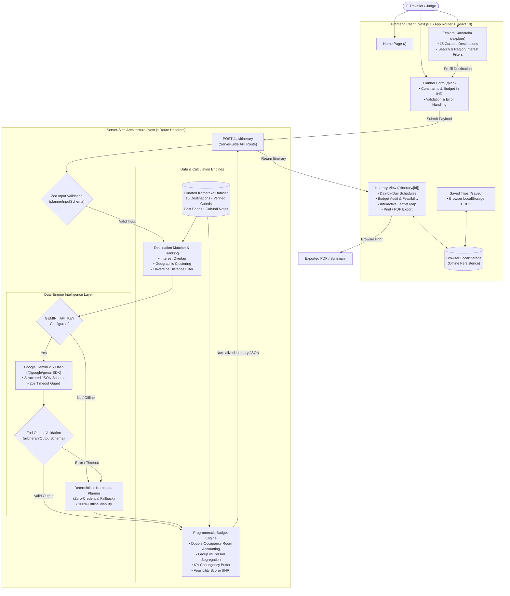

# NammaTrip AI — Your Intelligent Karnataka Travel Planner
> **Kannada Digital Innovation Hackathon 2026**  
> **Problem Statement 06 — TRAVEL & TOURISM: AI Travel Planner for Karnataka**  
> Organized by HackerRank Campus Crew • The National Institute of Engineering (NIE), Mysuru

[](https://nextjs.org/)
[](https://www.typescriptlang.org/)
[](https://tailwindcss.com/)
[](https://vitest.dev/)
[](LICENSE)

---

## 1. Problem Statement & Scope

**Problem Statement 06 — TRAVEL & TOURISM: AI Travel Planner for Karnataka**

> *"Develop an AI-powered travel planner that creates personalized Karnataka itineraries based on a traveller's interests, available time, budget, and preferred type of experience."*

Karnataka spans an extraordinary breadth of travel experiences: from the royal heritage boulevards of Mysuru and the UNESCO World Heritage ruins of Vijayanagara in Hampi, to the misty coffee ridges of Mullayanagiri and pristine Arabian Sea beaches in Gokarna.

Planning a personalized journey across this landscape currently requires hours of manual research across fragmented blogs, contradictory travel forums, and disjointed map tools. Travellers frequently struggle with:
1. **Unrealistic Geographic Routing:** Far-apart destinations packed into single days without accounting for Western Ghats road conditions.
2. **Hidden & Unclear Budgets:** Booking portals display isolated room or flight rates without calculating complete group expenses (fuel, tolls, food, monument tickets).
3. **Absence of Feasibility Advice:** No transparent mechanism to assess whether a planned trip fits the traveller's budget ceiling.

**NammaTrip AI** solves this problem by pairing curated, verified Karnataka destination intelligence with Google Gemini AI and a deterministic mathematical budget engine.

---

## 2. Product Vision & Target Users

> **Product Positioning:**  
> *"Tell NammaTrip your budget, available days, interests, and travel preferences. Get a personalized Karnataka travel plan with a day-wise schedule and a transparent cost breakdown in Indian Rupees (₹)."*

### Target Audiences
- **Students & Budget Backpackers:** Need transparent cost ceilings in INR, affordable KSRTC transport routes, and budget stays without surprise expenses.
- **Families & Holiday Groups:** Require balanced day-by-day pacing, double-occupancy hotel room allocation, and safe cultural/nature experiences.
- **First-Time Visitors & Solo Travellers:** Seek authentic cultural immersion (Mysore Dasara, Hampi ruins, Coorg coffee, Gokarna cliff walks) with zero planning fatigue.

---

## 3. Key Features

- **Personalized Constraint Engine:** Configure starting location, party size (1–20), duration (1–10 days), budget in INR, travel tier (Budget, Balanced, Comfort), and preferred transport mode (Public, Self-drive, Flexible).
- **Multi-Interest Personalization:** Select from 9 curated Karnataka themes: Heritage & History, Nature & Waterfalls, Hill Stations, Wildlife, Beaches, Local Food & Cuisine, Spiritual & Cultural, Adventure, and Family-Friendly.
- **Curated Karnataka Catalogue:** 15+ hand-curated destinations (Mysuru, Hampi, Coorg, Chikkamagaluru, Gokarna, Badami, Shivamogga, Bengaluru, Udupi, Kabini, Dandeli, Belur-Halebidu, Murudeshwar, Vijayapura, Bandipur) with verified coordinates, authentic Kannada script names, and daily cost ranges.
- **Dual-Engine Intelligence (AI + Offline Fallback):** Integrates Google Gemini 2.5 Flash for nuanced schedule design, with an automatic **Deterministic Knowledge Planner fallback** so judges can demo the entire application without needing an API key.
- **Programmatic INR Budget Breakdown:** Mathematically itemizes expenses into Transport, Accommodation (double-occupancy rooms), Food & Dining, Activity Admission Fees, and a 6% Contingency Buffer.
- **Feasibility Scorer & Overrun Advice:** Categorizes trips as *Within Budget*, *Close to Budget*, or *Likely Over Budget* with actionable advice to economize.
- **Interactive OpenStreetMap Route Map:** Plots verified latitude/longitude coordinates and connecting route polylines with Leaflet, plus fallback external map links.
- **Local Persistence & Export:** Zero login required. Save, retrieve, and delete itineraries in browser `localStorage`, copy formatted text summaries to clipboard, or export clean printable PDFs via browser print styles.

---

## 4. System Architecture



---

## 5. Technology Stack

| Layer | Technologies Used | Rationale |
| :--- | :--- | :--- |
| **Framework** | Next.js 16.4.3 (App Router), React 19 | Server-side rendering, streaming, fast partial prerendering, zero client bloat. |
| **Language** | TypeScript (Strict mode) | Complete type-safety across domain models, inputs, and schemas. |
| **Styling** | Tailwind CSS v4, Custom Editorial Theme | Curated palette (Deep forest green `#1B4332`, Warm ivory `#FAF7F2`, Terracotta `#C85A32`). |
| **Icons** | Lucide React | High-contrast, accessible, and consistent iconography. |
| **Validation** | Zod v4 | Runtime input validation for API routes and Gemini JSON schema enforcement. |
| **AI Integration** | Google Gemini 2.5 Flash via official `@google/genai` | Structured JSON generation, low latency, 25-second timeout guard. |
| **Mapping** | Leaflet with OpenStreetMap tiles | Open-source mapping without proprietary API keys; verified coordinates. |
| **Storage** | Browser `localStorage` | Zero-signup persistence; persistent across tab reloads and offline sessions. |
| **Testing** | Vitest, JSDOM, React Testing Library | Fast unit and API route test suite with 100% passing tests. |
| **Presentation** | PptxGenJS | Programmatic generation of 16:9 editable `.pptx` presentation. |

---

## 6. Project Structure

```
├── public/                       # Static public assets
├── scripts/
│   └── generate-presentation.mjs # Programmatic 16:9 PPTX generator
├── src/
│   ├── app/                      # Next.js App Router
│   │   ├── api/
│   │   │   └── itinerary/
│   │   │       └── route.ts      # POST /api/itinerary endpoint
│   │   ├── explore/
│   │   │   └── page.tsx          # Destination discovery & filters
│   │   ├── itinerary/
│   │   │   └── [id]/
│   │   │       └── page.tsx      # Generated itinerary & route display
│   │   ├── plan/
│   │   │   └── page.tsx          # Trip constraint planner form
│   │   ├── saved/
│   │   │   └── page.tsx          # Saved trips management (localStorage)
│   │   ├── globals.css           # Brand palette, editorial styles, print rules
│   │   ├── layout.tsx            # Root layout with Navbar, Footer, and Viewport
│   │   └── page.tsx              # Landing Home page
│   ├── components/
│   │   ├── budget/
│   │   │   ├── BudgetBreakdown.tsx # Categorized cost breakdown
│   │   │   └── FeasibilityBadge.tsx # Within/Close/Over budget status
│   │   ├── destinations/
│   │   │   ├── DestinationCard.tsx # Destination card with image & tags
│   │   │   ├── DestinationDetailModal.tsx # Full guide modal
│   │   │   └── DestinationFilters.tsx # Search & category chips
│   │   ├── itinerary/
│   │   │   ├── ActivityItem.tsx   # Morning/Afternoon/Evening activity
│   │   │   ├── DayScheduleCard.tsx # Day timeline card
│   │   │   ├── ItineraryMap.tsx   # Leaflet OpenStreetMap route
│   │   │   └── ItineraryView.tsx  # Master itinerary page layout & toolbar
│   │   ├── layout/
│   │   │   ├── Footer.tsx         # Editorial footer & hackathon attribution
│   │   │   └── Navbar.tsx         # Responsive brand header
│   │   └── planner/
│   │       └── PlannerForm.tsx    # Multi-step constraint form with validation
│   ├── lib/
│   │   ├── ai/
│   │   │   ├── fallback-planner.ts # Deterministic zero-credential planner
│   │   │   ├── gemini.ts          # Google Gemini 2.5 Flash SDK service
│   │   │   └── prompts.ts         # Structured schema prompts
│   │   ├── budget/
│   │   │   └── calculations.ts    # Mathematical budget & feasibility engine
│   │   ├── destinations/
│   │   │   ├── data.ts            # Curated 15+ Karnataka destination catalogue
│   │   │   └── matching.ts        # Geographic clustering & interest ranking
│   │   ├── storage/
│   │   │   └── saved-trips.ts     # LocalStorage CRUD persistence
│   │   ├── validation/
│   │   │   └── itinerary-schema.ts # Zod schemas for input and AI output
│   │   └── utils.ts               # INR currency & string utilities
│   ├── tests/
│   │   ├── api.test.ts            # Route handler integration tests
│   │   ├── budget.test.ts         # Budget engine math & room count tests
│   │   ├── fallback.test.ts       # Deterministic generator integrity tests
│   │   ├── matching.test.ts       # Destination ranking & Haversine distance tests
│   │   ├── setup.ts               # Vitest environment setup
│   │   ├── storage.test.ts        # LocalStorage resilience tests
│   │   └── validation.test.ts     # Zod schema validation tests
│   └── types/
│       └── index.ts               # Domain TypeScript interfaces
├── submission/
│   ├── demo/
│   │   └── voiceover-script.md    # 4:30 minute timed demo script
│   ├── architecture.mmd           # Mermaid architecture diagram
│   ├── demo-checklist.md          # Video recording execution checklist
│   ├── final-checklist.md         # Official hackathon submission checklist
│   └── NammaTrip_AI_Hackathon_Presentation.pptx # Editable 16:9 presentation
├── .env.example                  # Environment template
├── .gitignore                    # Git ignore file (excludes secrets)
├── package.json                  # Dependencies & scripts
├── tsconfig.json                 # Strict TypeScript configuration
└── vitest.config.mts             # Vitest test configuration
```

---

## 7. Prerequisites

- **Node.js:** v18.0.0 or higher (Tested on Node.js v24.14.0)
- **Package Manager:** `npm` (Included with Node.js)
- **Git:** Git 2.20+

---

## 8. Local Installation & Setup

1. **Clone the Repository:**
   ```bash
   git clone <repository-url>
   cd "Kannada Digital Innovation Hackathon 2026"
   ```

2. **Install Dependencies:**
   ```bash
   npm install
   ```

3. **Configure Environment Variables (Optional):**
   Copy the `.env.example` file to `.env.local`:
   ```bash
   cp .env.example .env.local
   ```
   > **Note:** Configuring a Gemini API key is completely optional. If no key is set, NammaTrip AI automatically activates its built-in Karnataka Knowledge Planner, generating complete day-by-day itineraries and budgets.

4. **Run the Development Server:**
   ```bash
   npm run dev
   ```
   Open [http://localhost:3000](http://localhost:3000) in your browser.

---

## 9. Enabling Google Gemini AI (Optional)

To enable live Google Gemini AI generation:
1. Obtain a free API key from [Google AI Studio](https://aistudio.google.com/).
2. Open your `.env.local` file and add:
   ```env
   GEMINI_API_KEY=your_actual_gemini_api_key_here
   GEMINI_MODEL=gemini-2.5-flash
   ```
3. Restart the dev server (`npm run dev`). Generated itineraries will now indicate `AI Generated via Google Gemini`.
4. If the key is invalid, rate-limited, or offline, the app seamlessly falls back to the deterministic planner with zero crashes.

---

## 10. Running Automated Tests & Quality Checks

Run the complete suite of quality checks:

```bash
# 1. Run all 17 automated unit and API tests
npm run test

# 2. Run TypeScript strict type-checking
npm run typecheck

# 3. Run ESLint code quality checks
npm run lint

# 4. Build optimized Next.js production bundle
npm run build

# 5. Regenerate the 16:9 PPTX hackathon presentation
npm run generate-ppt
```

### Current Status
- **Vitest Test Suite:** `17 passed (17 total)` across 6 test suites (`budget.test.ts`, `matching.test.ts`, `validation.test.ts`, `fallback.test.ts`, `storage.test.ts`, `api.test.ts`).
- **TypeScript:** `0 errors` (Strict mode).
- **ESLint:** `0 errors`, `0 warnings`.
- **Production Build:** `100% Successful` optimized static and dynamic routes.

---

## 11. Deployment to Vercel

NammaTrip AI is designed for seamless, zero-configuration deployment to [Vercel](https://vercel.com):

1. Push your repository to GitHub.
2. Sign in to [Vercel](https://vercel.com) and click **"Add New Project"**.
3. Import your `nammatrip-ai` repository.
4. In the **Environment Variables** section (optional):
   - Add `GEMINI_API_KEY` (if you want live AI synthesis on production).
   - Add `GEMINI_MODEL=gemini-2.5-flash`.
5. Click **"Deploy"**.
6. Vercel will run `npm run build` and provision your live HTTPS URL (e.g. `https://nammatrip-ai.vercel.app`).

---

## 12. Hackathon Presentation & Video Demo

All submission assets are generated and organized in the `submission/` directory:

- **Editable Presentation (PPTX):** [`submission/NammaTrip_AI_Hackathon_Presentation.pptx`](submission/NammaTrip_AI_Hackathon_Presentation.pptx) (16:9 widescreen, 8 structured slides covering problem, existing gaps, differentiation, approach, architecture, demo, and future scope).
- **Video Voiceover Script (4:30 min):** [`submission/demo/voiceover-script.md`](submission/demo/voiceover-script.md) (Timestamped narration with screen-recording directions).
- **Video Recording Checklist:** [`submission/demo-checklist.md`](submission/demo-checklist.md) (Step-by-step recording guide).
- **Architecture Diagram:** [`submission/architecture.mmd`](submission/architecture.mmd) (Mermaid workflow diagram).
- **Final Submission Checklist:** [`submission/final-checklist.md`](submission/final-checklist.md) (Pre-submission verification for Unstop).

---

## 13. Data Transparency & Planning Disclaimers

- **Illustrative Estimates:** All admission tickets, hotel rates, and transport fares are calculated in Indian Rupees (₹) based on verified baseline Karnataka tourism averages. Real-world prices fluctuate based on seasonality (e.g. Mysuru Dasara festival in October/November), fuel price changes, and booking lead times.
- **No Fabricated Live Data:** NammaTrip AI does not invent fake real-time flight bookings, guaranteed hotel availability, or live ticket seat counts.
- **Cultural Respect:** Travellers are reminded to confirm opening hours, photography permits, and traditional dress guidelines at sacred heritage sanctums prior to travel.

---

## 14. External Asset Attribution

- **Destination Imagery:** Publicly accessible photographs from Unsplash under the Unsplash License.
- **Mapping:** Tiles and geographic data courtesy of [OpenStreetMap](https://www.openstreetmap.org/) contributors under the Open Database License (ODbL).
- **Icons:** [Lucide Icons](https://lucide.dev/) under the ISC License.

---

## 15. License

This project is licensed under the MIT License — see the [LICENSE](LICENSE) file for details.
