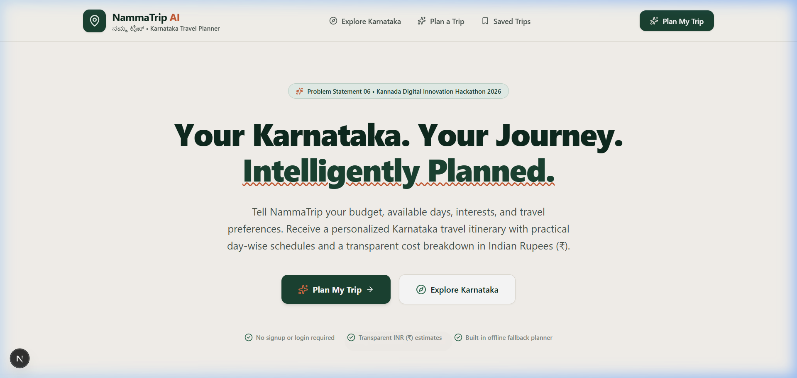
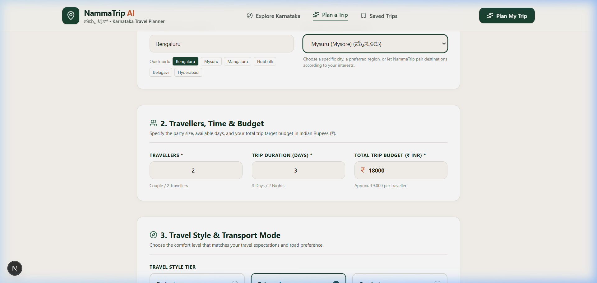
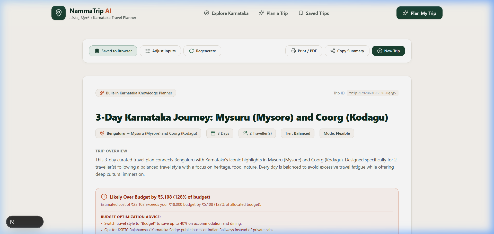
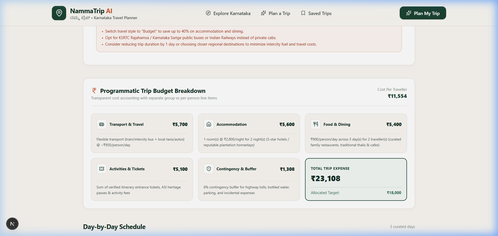
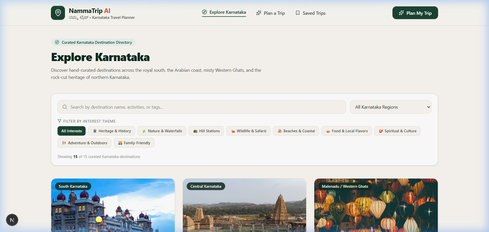
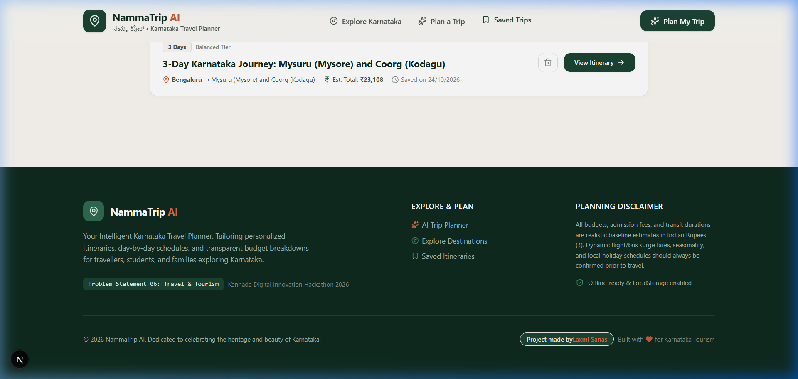

# NammaTrip AI — AI-Powered Travel Planner for Karnataka

> **Kannada Digital Innovation Hackathon 2026**  
> **Problem Statement 06 (PS06) — TRAVEL & TOURISM: AI Travel Planner for Karnataka**  
> Organized by HackerRank Campus Crew • The National Institute of Engineering (NIE), Mysuru  

[](https://nammatrip-ai-neon.vercel.app/)
[](https://github.com/laxmisanas07/nammatrip-ai)

[](https://nextjs.org/)
[](https://react.dev/)
[](https://www.typescriptlang.org/)
[](https://tailwindcss.com/)
[](https://vitest.dev/)
[](LICENSE)

---

## 👨‍💻 Project Credits

| Parameter | Details |
| :--- | :--- |
| **Created by** | **Laxmi Sanas** |
| **Project Name** | **NammaTrip AI** (*ನಮ್ಮ ಟ್ರಿಪ್*) — Your Intelligent Karnataka Travel Planner |
| **Live Web App** | [https://nammatrip-ai-neon.vercel.app/](https://nammatrip-ai-neon.vercel.app/) |
| **Source Code** | [https://github.com/laxmisanas07/nammatrip-ai](https://github.com/laxmisanas07/nammatrip-ai) |
| **Hackathon** | Kannada Digital Innovation Hackathon 2026 |
| **Problem Statement** | **PS06 — TRAVEL & TOURISM: AI Travel Planner for Karnataka** |
| **Core Architecture** | Next.js 16 App Router, React 19, Google Gemini 2.5 Flash, Deterministic Fallback Engine, Leaflet OpenStreetMap, Zod Runtime Validation |

---

## 📑 Table of Contents

1. [Project Overview](#-project-overview)
2. [Visual Project Previews (Screenshots)](#-visual-project-previews)
3. [Problem Statement & Scope (PS06)](#-problem-statement--scope-ps06)
4. [Proposed Solution & Key Innovations](#-proposed-solution--key-innovations)
5. [Core Features](#-core-features)
6. [Full-Stack System Architecture](#-full-stack-system-architecture)
7. [Technology Stack](#-technology-stack)
8. [Project Folder Structure](#-project-folder-structure)
9. [Getting Started & Local Installation](#-getting-started--local-installation)
10. [Enabling Google Gemini AI (Optional)](#-enabling-google-gemini-ai-optional)
11. [Quality Assurance & Automated Tests](#-quality-assurance--automated-tests)
12. [Vercel Deployment Guide](#-vercel-deployment-guide)
13. [Hackathon Presentation Deliverables](#-hackathon-presentation-deliverables)
14. [Transparency & Planning Disclaimers](#-transparency--planning-disclaimers)
15. [Author & Creator Attribution](#-author--creator-attribution)

---

## 🌟 Project Overview

**NammaTrip AI** (*ನಮ್ಮ ಟ್ರಿಪ್*) is an intelligent, full-stack travel-planning web application engineered specifically for Karnataka's tourism ecosystem. 

Planning a holiday across Karnataka often leads to cognitive overload: travelers jump between contradictory blogs, guess transit durations across Western Ghats ghat sections, and deal with opaque travel portals that hide real group expenses.

NammaTrip AI solves this by combining **curated Karnataka destination knowledge**, **Google Gemini 2.5 Flash**, a **resilient offline fallback engine**, and a **programmatic INR budget auditor**. Whether you are a student backpacker on a strict ₹4,000 budget or a family exploring royal Mysuru and the coffee estates of Coorg, NammaTrip AI synthesizes a realistic, day-by-day travel itinerary with verified timings, interactive maps, and complete cost transparency in under 60 seconds.

---

## 📸 Visual Project Previews

All screenshots are captured directly from the live running application:

### 1. Homepage & Hero Section
*Editorial landing experience celebrating Karnataka tourism with quick CTAs, bilingual Kannada branding, and core capability highlights.*



---

### 2. Interactive AI Trip Planner (`/plan`)
*Configure trip constraints: origin city, preferred destination, party size (1–20), duration (1–10 days), budget in INR, travel tier, and 9 interest themes.*



---

### 3. Generated Day-by-Day Itinerary (`/itinerary/[id]`)
*Synthesized multi-day schedule with morning, afternoon, and evening activity cards, cultural context, and interactive action toolbar (Save, Print, Copy).*



---

### 4. Programmatic Budget Ledger & Feasibility Engine
*Itemized financial accounting separating Transport, Accommodation (double-occupancy logic), Food & Dining, Activity Admissions, and a 6% Contingency Buffer with actionable economizing tips.*



---

### 5. Curated Karnataka Destination Directory (`/explore`)
*15+ verified Karnataka destinations spanning the Royal South, Western Ghats, Coastal Karavali, and Northern rock-cut heritage circuits.*



---

### 6. Local Storage Dashboard & Creator Credit Footer (`/saved`)
*Zero-login browser persistence storing planned trips locally, complete with the verified creator credit badge naming **Laxmi Sanas** in the shared footer.*



---

## 🎯 Problem Statement & Scope (PS06)

**Official Problem Statement:**
> **06 — TRAVEL & TOURISM: AI Travel Planner for Karnataka**  
> *"Develop an AI-powered travel planner that creates personalized Karnataka itineraries based on a traveller's interests, available time, budget, and preferred type of experience."*

### Key Travellers Gaps Solved

| Problem in Existing Planning | How NammaTrip AI Solves It |
| :--- | :--- |
| **Fragmented Research** | Travellers check 8–12 tabs (blogs, forums, maps). NammaTrip consolidates routing, timings, entry rules, and Kannada names in a unified view. |
| **Budget Guesswork** | Commercial OTAs show isolated room or bus fares. NammaTrip itemizes total group expenses (stays, meals, fuel, tolls, ASI monument passes). |
| **Geographic Infeasibility** | Generic AI wrappers hallucinate unrealistic drives (e.g. Gokarna to Hampi in 1 day). NammaTrip applies geographic clustering and Western Ghats speed realities. |
| **Fragile AI Prompts** | Many hackathon prototypes crash when API keys expire. NammaTrip implements a **Dual-Engine Architecture** that falls back seamlessly to a deterministic planner. |

---

## 💡 Proposed Solution & Key Innovations

1. **Dual-Engine Intelligence (Gemini 2.5 Flash + Deterministic Fallback):**
   - High-performance Google Gemini 2.5 Flash integration via the official `@google/genai` SDK.
   - If an API key is not configured, expired, or rate-limited, the system automatically activates the **Deterministic Knowledge Planner**, generating complete, realistic schedules without crashing.
2. **Programmatic INR Budget Auditor:**
   - Evaluates lodging math based on double-occupancy formulas ($\lceil \text{travellers} / 2 \rceil$).
   - Computes daily meals, intercity transit, verified ASI monument entrance fees, and a 6% contingency buffer.
   - Categorizes budget feasibility (*Within Budget*, *Close to Budget*, or *Likely Over Budget*) with dynamic recommendations.
3. **Interactive OpenStreetMap Visualization:**
   - Free, open-source geospatial routing powered by Leaflet and OpenStreetMap tiles.
   - Maps exact latitude/longitude coordinates with customized numbered markers and route polylines.
4. **Zero-Login Browser Persistence:**
   - Automatically saves generated trips to browser `localStorage`.
   - Dedicated `/saved` management dashboard with full view, delete, and copy features.
5. **Print-to-PDF Dossier Export:**
   - Custom `@media print` CSS formats the complete itinerary into a clean, multi-page PDF document, stripping navigation chrome and buttons.

---

## 🚀 Core Features

- **Personalized Constraint Engine:** Select starting point (Bengaluru, Mysuru, Mangaluru, Hubballi, etc.), party size (1–20), trip length (1–10 days), target budget (₹1,000 to ₹20,00,000), and travel tier (*Budget*, *Balanced*, *Comfort*).
- **9 Curated Karnataka Interest Themes:** Heritage & History, Nature & Waterfalls, Hill Stations, Wildlife & Safaris, Beaches & Coastal, Local Food & Flavors, Spiritual & Culture, Adventure & Outdoors, and Family-Friendly.
- **Curated 15-Destination Karnataka Directory:** Mysuru, Hampi, Coorg, Chikkamagaluru, Gokarna, Badami, Shivamogga, Bengaluru, Udupi, Kabini, Dandeli, Belur-Halebidu, Murudeshwar, Vijayapura, Bandipur.
- **Card-to-Planner Prefilling:** Clicking *"Plan Trip"* on any destination card automatically prefills and opens the planner form.
- **Bilingual Cultural Context:** Features native Kannada script (*ಕನ್ನಡ*) alongside English names, authentic regional cuisine highlights (Mylari Dosa, Mysore Pak, Neer Dosa, Jolada Rotti), and temple etiquette guidance.

---

## 🏗 Full-Stack System Architecture


---

## 🛠 Technology Stack

| Layer | Technology | Version | Purpose |
| :--- | :--- | :--- | :--- |
| **Framework** | Next.js App Router | `16.4.3` | Full-stack architecture, React Server Components, Partial Prerendering (PPR) |
| **UI Library** | React | `19.3.0` | Modern declarative component model |
| **Language** | TypeScript | `^5` | Strict type safety across inputs, schemas, and domain interfaces |
| **Styling** | Tailwind CSS | `v4` | Bespoke editorial travel-tech design system |
| **Validation** | Zod | `^4.6.7` | Strict runtime schema validation for API inputs and AI outputs |
| **AI Model** | Google Gemini 2.5 Flash | via `@google/genai` | Structured generative itinerary synthesis with schema enforcement |
| **Mapping** | Leaflet & OpenStreetMap | `^1.9.4` | Open-source geographic rendering without API key friction |
| **Icons** | Lucide React | `^1.61.0` | Clean, accessible iconography |
| **Testing** | Vitest | `^5.0.5` | Fast unit, integration, and API test suite (18/18 passing) |
| **Presentation** | PptxGenJS | `^4.0.1` | Programmatic 16:9 widescreen presentation deck generation |
| **Deployment** | Vercel | Production | Edge caching, automated GitHub deployments, HTTPS |

---

## 📁 Project Folder Structure

```
nammatrip-ai/
├── docs/
│   └── screenshots/              # Real high-resolution project screenshots
│       ├── 01-homepage.png
│       ├── 02-trip-planner.png
│       ├── 03-itinerary.png
│       ├── 04-budget-breakdown.png
│       ├── 05-destinations.png
│       └── 06-saved-trip.png
├── public/                       # Static public assets
│   ├── images/
│   │   └── destinations/         # High-quality local Karnataka destination photos
│   │       ├── hampi.jpg
│   │       └── murudeshwar.jpg
│   ├── file.svg
│   ├── globe.svg
│   ├── next.svg
│   ├── vercel.svg
│   └── window.svg
├── scripts/
│   └── generate-presentation.mjs # Programmatic 16:9 PPTX generator script
├── src/
│   ├── app/                      # Next.js App Router
│   │   ├── api/
│   │   │   └── itinerary/
│   │   │       └── route.ts      # POST /api/itinerary validation & synthesis handler
│   │   ├── explore/
│   │   │   └── page.tsx          # 15-Destination catalogue & filter view
│   │   ├── itinerary/
│   │   │   └── [id]/
│   │   │       └── page.tsx      # Generated itinerary, map, and budget page
│   │   ├── plan/
│   │   │   └── page.tsx          # Constraint form & parameter selector
│   │   ├── saved/
│   │   │   └── page.tsx          # Saved trips management (localStorage)
│   │   ├── globals.css           # Design tokens, color palette, print styling
│   │   ├── layout.tsx            # Global layout with responsive Navbar and Footer
│   │   └── page.tsx              # Landing homepage
│   ├── components/
│   │   ├── budget/
│   │   │   ├── BudgetBreakdown.tsx # Categorized expense ledger
│   │   │   └── FeasibilityBadge.tsx # Within / Close / Over budget badges
│   │   ├── destinations/
│   │   │   ├── DestinationCard.tsx # Destination preview card with fallback image
│   │   │   ├── DestinationDetailModal.tsx # Comprehensive travel guide modal
│   │   │   └── DestinationFilters.tsx # Search bar & thematic category chips
│   │   ├── itinerary/
│   │   │   ├── ActivityItem.tsx   # Morning/Afternoon/Evening activity card
│   │   │   ├── DayScheduleCard.tsx # Day timeline card
│   │   │   ├── ItineraryMap.tsx   # Leaflet OpenStreetMap route visualizer
│   │   │   └── ItineraryView.tsx  # Master itinerary page layout & action toolbar
│   │   ├── layout/
│   │   │   ├── Footer.tsx         # Shared footer with "Project made by Laxmi Sanas"
│   │   │   └── Navbar.tsx         # Brand header & mobile navigation drawer
│   │   └── planner/
│   │       └── PlannerForm.tsx    # Multi-step validated constraint form
│   ├── lib/
│   │   ├── ai/
│   │   │   ├── fallback-planner.ts # Deterministic zero-credential planner
│   │   │   ├── gemini.ts          # Google Gemini 2.5 Flash SDK service
│   │   │   └── prompts.ts         # System instructions & JSON output schema
│   │   ├── budget/
│   │   │   └── calculations.ts    # Mathematical budget engine & feasibility auditor
│   │   ├── destinations/
│   │   │   ├── data.ts            # Curated 15+ Karnataka destination catalogue
│   │   │   └── matching.ts        # Geographic clustering & interest ranking
│   │   ├── storage/
│   │   │   └── saved-trips.ts     # LocalStorage CRUD persistence
│   │   ├── validation/
│   │   │   └── itinerary-schema.ts # Zod validation schemas
│   │   └── utils.ts               # INR currency & formatting utilities
│   ├── tests/
│   │   ├── api.test.ts            # API route handler tests
│   │   ├── budget.test.ts         # Programmatic budget calculation tests
│   │   ├── fallback.test.ts       # Fallback planner & invalid key resilience tests
│   │   ├── matching.test.ts       # Destination ranking & distance tests
│   │   ├── setup.ts               # Vitest environment setup
│   │   ├── storage.test.ts        # LocalStorage fault-tolerance tests
│   │   └── validation.test.ts     # Zod schema validation tests
│   └── types/
│       └── index.ts               # Domain TypeScript interfaces
├── submission/
│   ├── slide-previews/           # 1080p slide previews & full-deck montage
│   │   ├── deck_overview.png
│   │   └── slide_1.png ... slide_8.png
│   ├── architecture.mmd           # Mermaid architecture diagram
│   ├── final-checklist.md         # Official hackathon submission checklist
│   ├── NammaTrip_AI_Hackathon_Presentation.pptx # Editable 16:9 presentation
│   └── NammaTrip_AI_Hackathon_Presentation_backup.pptx # Preserved backup
├── .env.example                  # Environment template (placeholders only)
├── .gitignore                    # Excludes secrets, node_modules, and .next
├── package.json                  # Dependencies & scripts
├── tsconfig.json                 # Strict TypeScript configuration
└── vitest.config.mts             # Vitest test configuration
```

---

## 💻 Getting Started & Local Installation

### Prerequisites
- **Node.js:** v18.0.0 or higher (Tested on Node.js v24.14.0)
- **Package Manager:** `npm` (Included with Node.js)
- **Git:** Git 2.20+

### Step-by-Step Setup

1. **Clone the repository:**
   ```bash
   git clone https://github.com/laxmisanas07/nammatrip-ai.git
   cd nammatrip-ai
   ```

2. **Install dependencies:**
   ```bash
   npm install
   ```

3. **Configure Environment Variables (Optional):**
   Copy `.env.example` to `.env.local`:
   ```bash
   cp .env.example .env.local
   ```
   > **Note:** The application works 100% out-of-the-box using the built-in deterministic fallback planner even if `GEMINI_API_KEY` is left blank.

4. **Start the development server:**
   ```bash
   npm run dev
   ```
   Open [http://localhost:3000](http://localhost:3000) in your browser.

---

## 🤖 Enabling Google Gemini AI (Optional)

To enable live Google Gemini 2.5 Flash synthesis:
1. Obtain a free API key from [Google AI Studio](https://aistudio.google.com/).
2. Open `.env.local` and add your key:
   ```env
   GEMINI_API_KEY=your_actual_gemini_api_key_here
   GEMINI_MODEL=gemini-2.5-flash
   ```
3. Restart your dev server (`npm run dev`).
4. **Resilience Guarantee:** If your API key is invalid, offline, or exhausts its quota, NammaTrip AI automatically catches the error and switches to the deterministic knowledge planner without throwing a 500 error.

---

## 🧪 Quality Assurance & Automated Tests

All tests and quality checks pass locally and in CI:

```bash
# Run all 18 automated unit and integration tests
npm test

# Run TypeScript strict type-checking (0 errors)
npm run typecheck

# Run ESLint code quality rules (0 warnings)
npm run lint

# Build optimized Next.js production bundle
npm run build

# Regenerate editable 16:9 PowerPoint presentation
npm run generate-ppt
```

### Verification Results Summary

| Check | Tool | Result |
| :--- | :--- | :--- |
| **Unit & Integration Tests** | Vitest 5 (`--pool=threads`) | **18 of 18 Passed (100%)** |
| **Type Safety** | TypeScript `tsc --noEmit` | **0 Errors** (Strict Mode) |
| **Code Style** | ESLint 9 Core Web Vitals | **0 Errors, 0 Warnings** |
| **Production Build** | Next.js 16 + Turbopack | **Compiled Successfully (9 Routes)** |
| **Credential Security** | Regex Ripgrep Scan | **0 Leaks Found** |

---

## 🌐 Vercel Deployment Guide

NammaTrip AI is deployed live on Vercel at:  
👉 **[https://nammatrip-ai-neon.vercel.app/](https://nammatrip-ai-neon.vercel.app/)**

### To Deploy Your Own Copy:
1. Fork or push this repository to your GitHub account.
2. Sign in to [Vercel](https://vercel.com) and click **"Add New Project"**.
3. Import your `nammatrip-ai` repository.
4. Framework Preset: **Next.js** (detected automatically).
5. (Optional) Add `GEMINI_API_KEY` in Environment Variables.
6. Click **"Deploy"**. Vercel will build and provision an HTTPS deployment.

---

## 📊 Hackathon Presentation Deliverables

The complete hackathon submission materials are located in the `submission/` directory:

- **Editable Presentation Deck (PPTX):** [`submission/NammaTrip_AI_Hackathon_Presentation.pptx`](submission/NammaTrip_AI_Hackathon_Presentation.pptx)  
  *Widescreen 16:9 presentation repaired, formatted, and verified across all 8 slides.*
- **Full-Deck Montage:** [`submission/slide-previews/deck_overview.png`](submission/slide-previews/deck_overview.png)
- **High-Resolution Previews:** [`submission/slide-previews/slide_1.png`](submission/slide-previews/slide_1.png) to [`slide_8.png`](submission/slide-previews/slide_8.png)
- **Presentation Generator Script:** [`scripts/generate-presentation.mjs`](scripts/generate-presentation.mjs)
- **Final Submission Checklist:** [`submission/final-checklist.md`](submission/final-checklist.md)

---

## ⚠️ Transparency & Planning Disclaimers

- **Realistic Baselines:** All hotel rates, meal costs, and transport estimates are based on verified Karnataka baseline averages in Indian Rupees (₹). Real prices vary during peak festive seasons (e.g. Mysuru Dasara in October/November) and monsoon road closures in the Western Ghats.
- **No Fabricated Live Data:** NammaTrip AI provides algorithmic feasibility models rather than fabricated live airline or hotel booking inventory.
- **Temple Etiquette & Conservation:** Travellers are advised to respect traditional dress codes at sacred pilgrim temples (e.g. Dharmasthala, Udupi, Kukke Subramanya) and obtain required forest permits for wildlife safari reserves.

---

## 👤 Author & Creator Attribution

This project was built from the ground up for the **Kannada Digital Innovation Hackathon 2026**:

- **Creator:** **Laxmi Sanas**
- **GitHub:** [@laxmisanas07](https://github.com/laxmisanas07)
- **Repository:** [https://github.com/laxmisanas07/nammatrip-ai](https://github.com/laxmisanas07/nammatrip-ai)
- **Live Deployment:** [https://nammatrip-ai-neon.vercel.app/](https://nammatrip-ai-neon.vercel.app/)

*Dedicated to celebrating the rich heritage, culture, and natural beauty of Karnataka.*
